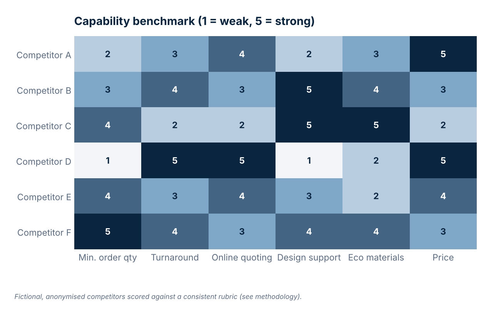
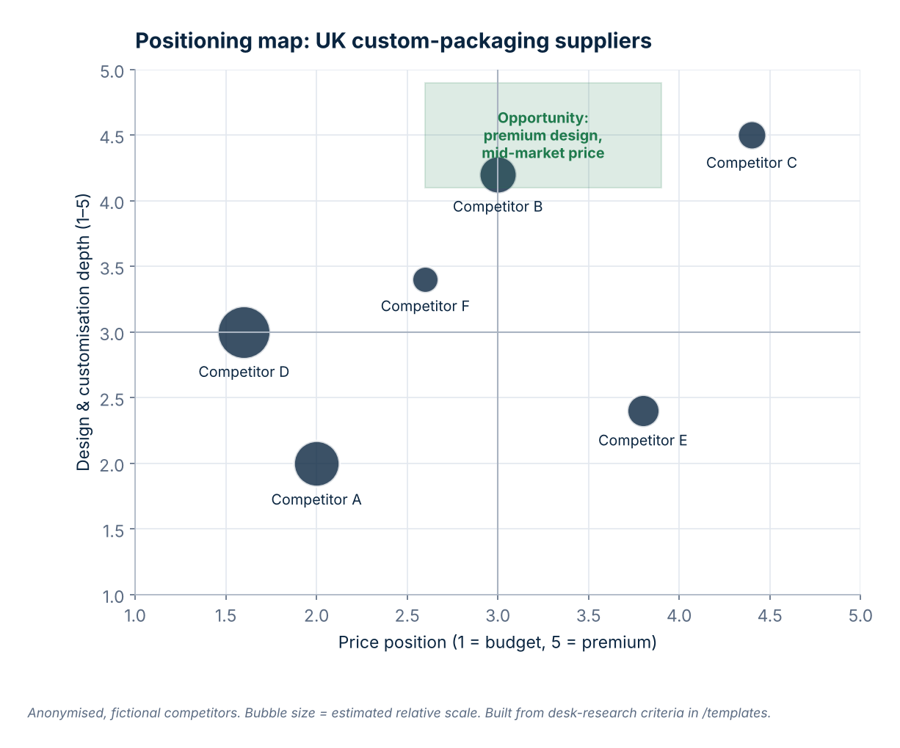

# Competitive Intelligence: UK Custom-Packaging Market

**Where can a small UK custom-packaging supplier win against larger, cheaper competitors?** This project shows a structured, evidence-based way to benchmark competitors and find a defensible position.

> **Data note.** Competitors A–F are **fictional and anonymised**, and their scores are illustrative. The scoring rubric, research log and method are reusable on real desk research. No information from any employer is used.

---

## 1. The business problem

Small packaging suppliers sell to e-commerce brands, gift companies and food businesses. Buyers can compare prices online in minutes, and large print-on-demand platforms compete hard on price. A smaller supplier that competes on price alone loses margin. It needs to know **which buyer needs are underserved** and **which it can credibly own**.

## 2. Objectives

1. Benchmark six competitors on the criteria buyers actually use.
2. Map the market to find white space.
3. Translate findings into a positioning and a short list of actions.

## 3. Methodology

| Stage | What was done |
|---|---|
| Define criteria | Six buyer-led criteria: minimum order quantity, turnaround, online quoting, design support, eco materials, price |
| Build a rubric | Each criterion scored 1 / 3 / 5 against **fixed definitions** so scores are comparable ([rubric](templates/competitor-benchmark.xlsx)) |
| Gather evidence | Websites, like-for-like quote requests on a standard spec, product pages, certifications, reviews; every finding logged with source and confidence |
| Weight & score | Criteria weighted by buyer importance; weighted score per competitor |
| Map & interpret | Positioning map (price vs design depth); SWOT for the client |

## 4. Findings

**Three patterns stand out (sample data):**

1. **The market splits in two.** Budget platforms (D, A) win on price and online quoting but offer little design help. Premium studios (C) offer design and eco materials but are slow and expensive.
2. **The mid-market premium space is thin.** Only Competitor B combines strong design support with a mid-market price, and its online quoting is average.
3. **Low minimum order quantities are rare among design-led suppliers.** Small brands that want premium design in short runs are underserved.

## 5. SWOT for the client (a small, design-capable supplier)

| Strengths | Weaknesses |
|---|---|
| In-house design support; flexible short runs; personal service | Smaller buying power on board; limited automation |
| **Opportunities** | **Threats** |
| Design-led short runs for growing D2C brands; eco-material upgrade; instant online quote | Board price volatility; platforms adding design services; price-led buyers |

## 6. Recommendations

1. **Position as "premium design, mid-market price, short runs"**, the white space on the map.
2. **Close the online quoting gap** with a simple instant-quote form for the 5 most common box styles. Buyers rule out suppliers who can't give a fast price.
3. **Make eco materials a standard option**, not a premium extra, to neutralise Competitor C's advantage.
4. **Protect margin** with quote costing linked to live board prices (see [Pricing & Revenue Modelling](https://github.com/sohaibshabbir9-del/pricing-and-revenue-modelling)).
5. **Re-run the benchmark every six months**; log changes in the research log.

## 7. Deliverables

| File | Contents |
|---|---|
| [`templates/competitor-benchmark.xlsx`](templates/competitor-benchmark.xlsx) | **Benchmark** matrix with editable weights, weighted scores and rank, plus the client's target position · **Scoring rubric** · **Research log** template |

## 8. How to use

1. Replace Competitors A–F with real names and score each against the **rubric**, logging every source in the **research log**.
2. Set weights from customer interviews ("what matters most when you choose a supplier?").
3. Compare the client's target row with the leaders and prioritise the gaps that buyers weight most.

---

Prepared by <a href="https://github.com/sohaibshabbir9-del">Sohaib Shabbir</a> · Market research & competitive intelligence · Fictional competitors for portfolio purposes.
